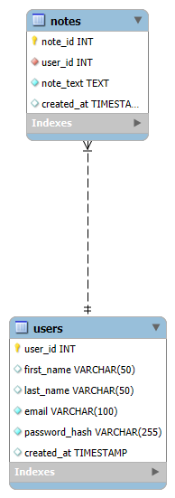
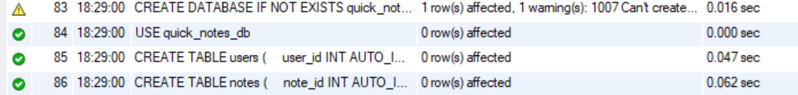
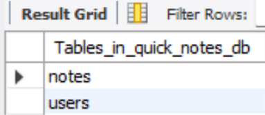

# Project Name: Quick Notes App

## Purpose
This application allows users to store, organize, and manage short personal notes online.

## Intended User
Students and professionals looking for a simple tool to write down quick thoughts.

## Key Features
- User registration and login
- Create new notes
- View, edit, and delete existing notes

---

## Database Design & ERD

### Business Rules
1. A **USER** may create any number of **NOTES**.
2. Each **NOTE** must be created by exactly one **USER**.

### Entity Relationship Diagram (ERD)

### Relations and Normalization
The formal relational schema derived from the ERD is structured as follows:

* **`users`** (`user_id` (PK), `first_name`, `last_name`, `email`, `password_hash`, `created_at`)
* **`notes`** (`note_id` (PK), `user_id` (FK), `note_text`, `created_at`)

**Normalization Analysis:**
* **First Normal Form (1NF):** All attributes contain atomic, single-valued data, and every table has a defined primary key (`user_id` and `note_id`) ensuring row uniqueness.
* **Second Normal Form (2NF):** Both relations are in 1NF, and their primary keys consist of a single column (`user_id` and `note_id`), completely eliminating any partial functional dependencies.
* **Third Normal Form (3NF):** There are no transitive dependencies; all non-key attributes in both tables depend directly and solely on their respective primary keys.
---

## Database Implementation

- **Relational Database System:** MySQL Community Edition
- **Implemented Tables:** `users` and `notes`
- **Table Relationship:** The `users` table acts as the parent entity holding account information. The `notes` table acts as the child entity, utilizing a foreign key (`user_id`) that references `users(user_id)` in a One-to-Many relationship (one user can create multiple notes, but each note belongs to a single user).
- **Schema File:** [View schema.sql](./schema.sql)

### Table Creation Output

### Show Tables Output
